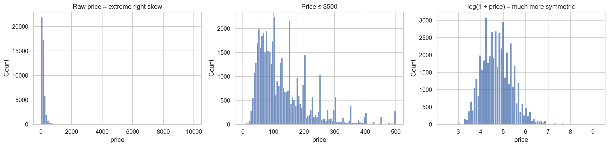
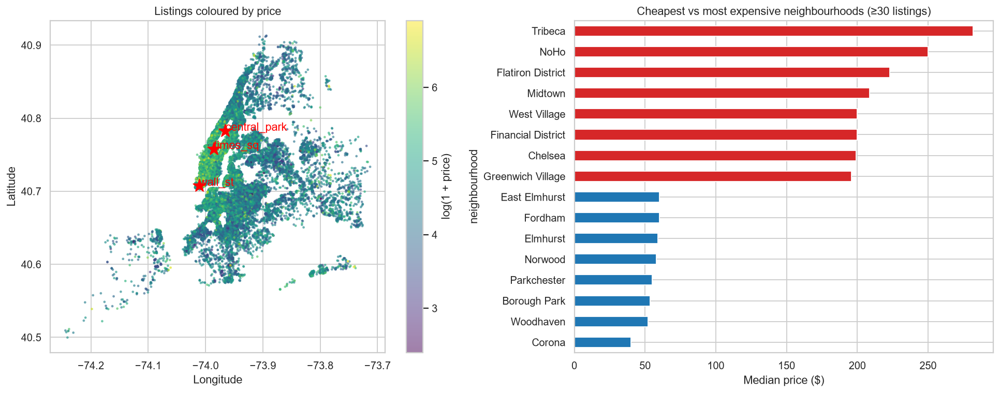
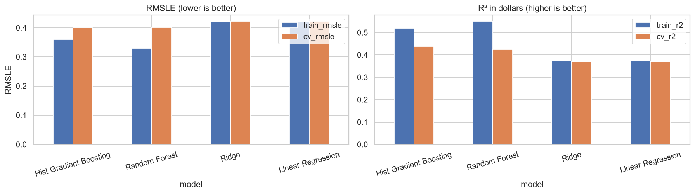
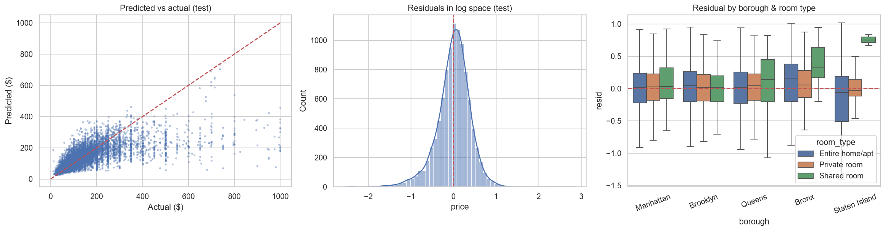
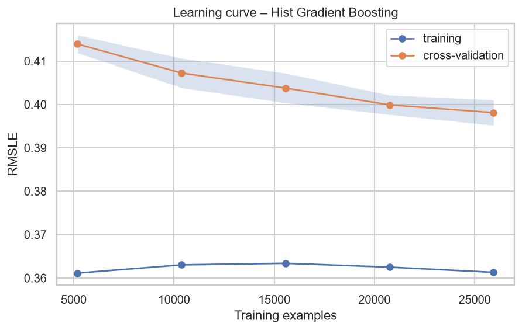
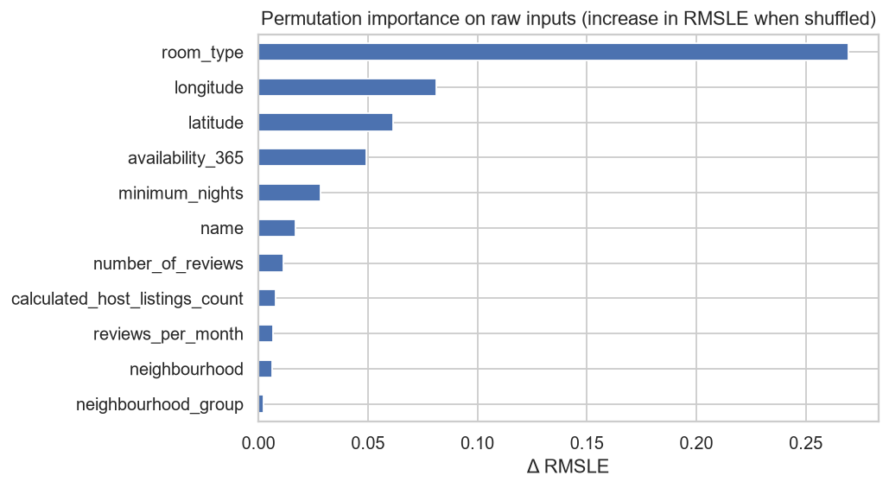
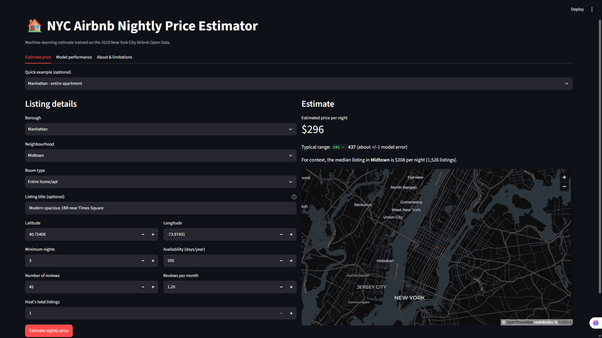

# 🏠 NYC Airbnb Price Prediction – End-to-End Machine Learning Project

DS605 – Fundamentals of Machine Learning · Lab Assignment 4

An end-to-end ML workflow on the Kaggle **New York City Airbnb Open Data (`AB_NYC_2019.csv`)**:
data cleaning → EDA → feature engineering/selection → model comparison → hyper-parameter tuning →
evaluation (incl. over-fitting checks) → saved pipeline → **Streamlit app** that estimates the nightly price of a listing.

**Deployed app:** _paste your Streamlit Community Cloud link here_

---

## 1. Repository structure

```
├── airbnb_price_prediction.ipynb     # full analysis notebook (Tasks 1, 2, 4)
├── airbnb_utils.py                   # shared cleaning / feature-engineering / modelling code
├── train.py                          # command-line version of the training workflow
├── app.py                            # Streamlit application (Task 3)
├── requirements.txt
├── data/AB_NYC_2019.csv              # Kaggle dataset
├── models/
│   ├── airbnb_price_pipeline.joblib  # saved full pipeline (features + encoding + model)
│   └── metadata.json                 # dropdown values, metrics and cleaning info used by the app
├── images/                           # plots and app screenshots
├── reports/                          # results.md, model_comparison.csv
└── tests/test_pipeline.py
```

**Run the app locally:** `pip install -r requirements.txt` then `streamlit run app.py` (from the repository root).

## 2. Method summary

| Stage      | What was done                                                                                                                                                                                                                    |
| ---------- | -------------------------------------------------------------------------------------------------------------------------------------------------------------------------------------------------------------------------------- |
| Cleaning   | duplicates removed; price < $10 (incl. $0 placeholders) and above the 99.5th percentile ($1,000) removed; `reviews_per_month` NaN → 0 (structural: no reviews); `name` NaN → ""; identifiers and `last_review` dropped           |
| Target     | trained on `log1p(price)` because price is heavily right-skewed; predictions are converted back to dollars automatically                                                                                                         |
| Features   | 3 categorical (borough, neighbourhood, room type; rare categories grouped) + 17 engineered numeric candidates (distance to Times Sq./Wall St./Central Park, log-transforms, flags, title keywords); mutual-information selection |
| Models     | Linear Regression, Ridge, Random Forest, Hist Gradient Boosting – 3-fold CV, metric RMSLE (+ MAE, R²)                                                                                                                            |
| Tuning     | `RandomizedSearchCV` (20 iterations, 3-fold) on the best family                                                                                                                                                                  |
| Evaluation | 80/20 hold-out test set; train-vs-test gap, learning curve, residual and per-price-bucket analysis, permutation importance                                                                                                       |
| Deployment | single saved scikit-learn pipeline (`joblib`) served by Streamlit                                                                                                                                                                |

## 3. Results

Trained with scikit-learn 1.8.0. **48,895** raw listings → **48,645** after cleaning (price kept between $10 and $1,000).
Final model: **Hist Gradient Boosting**, tuned with randomised search.

### Model comparison (3-fold cross-validation on the training set)

| Model                      | CV RMSLE ↓ | CV MAE ($) | CV R²     | Train R² | Train–CV gap (RMSLE) |
| -------------------------- | ---------- | ---------- | --------- | -------- | -------------------- |
| **Hist Gradient Boosting** | **0.399**  | **45.40**  | **0.439** | 0.520    | 0.040                |
| Random Forest              | 0.401      | 45.44      | 0.424     | 0.550    | 0.072                |
| Ridge                      | 0.422      | 48.19      | 0.369     | 0.372    | 0.002                |
| Linear Regression          | 0.422      | 48.20      | 0.369     | 0.372    | 0.002                |

The two tree ensembles clearly beat the linear models; Hist Gradient Boosting and Random Forest are nearly tied, and boosting is preferred for its slightly better CV score, smaller train–CV gap and much smaller model file.

### Final model: train vs. hold-out test

| Metric                  | Train  | Test   |
| ----------------------- | ------ | ------ |
| RMSE ($)                | 81.86  | 86.42  |
| MAE ($)                 | 41.90  | 44.65  |
| R²                      | 0.505  | 0.465  |
| RMSLE                   | 0.366  | 0.389  |
| R² (log price)          | 0.693  | 0.661  |
| Median absolute % error | 21.5 % | 22.6 % |

**Reading the results**

- **Generalisation:** train and test scores are close (R² 0.505 → 0.465; log-price R² 0.693 → 0.661), so there is no serious over-fitting.
- **Typical accuracy:** half of all predictions are within about 22 % of the true price (MAE ≈ $45).
- **RMSE ≫ MAE** ($86 vs $45) shows that a minority of expensive listings produce very large errors.
- **Explained variance:** the model explains roughly 47 % of price variance in dollars and 66 % in log-price. The remaining error comes mostly from information the dataset lacks (bedrooms, amenities, photos, ratings), not from model choice.

### Plots

|                                       |                                                 |
| ------------------------------------- | ----------------------------------------------- |
|  |  |
|    |                |
|      |        |

### Application screenshots




## 4. Limitations

- **2019 data** – prices today are different; retrain on a recent snapshot before real use.
- **Missing price drivers** – no bedrooms, amenities, photos, ratings or seasonality in the dataset, so accuracy has a ceiling.
- **Asking prices**, not realised booking prices.
- **Price range** – listings below $10 or above $1,000 are not modelled, and the most expensive listings are under-estimated.
- **Uncertainty** – the ±1-error range shown in the app is a population-level approximation, not a true per-listing prediction interval.
